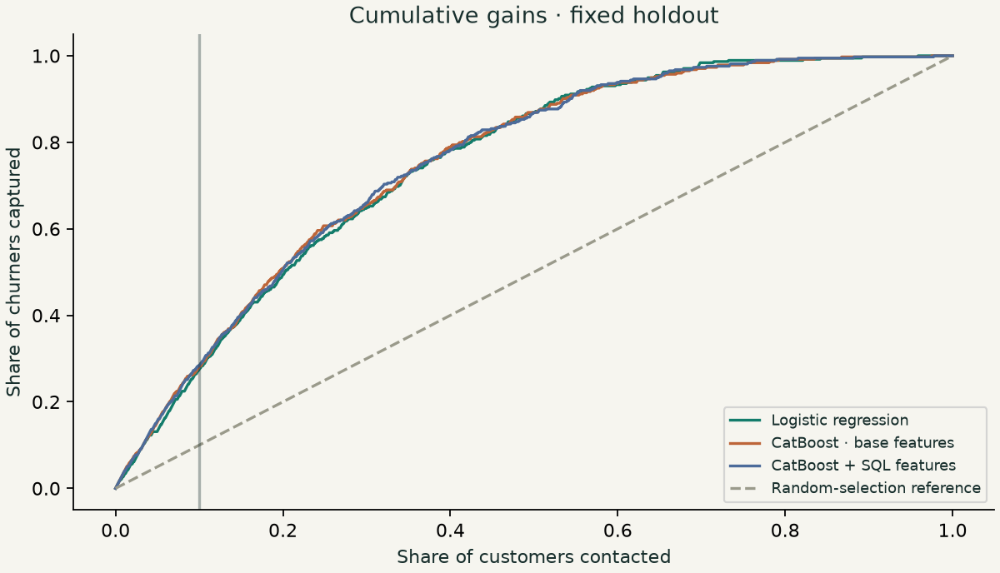

# Telco Churn Lab

**Churn modeling, probability reliability and retention campaign planning.**

Built by [Ainur Ali](https://github.com/AinurAliWl).

I built this project to connect a telecom classification model with a concrete decision: **which customers should a retention team contact when it can reach only a limited share of its customer base?**

The project combines SQL feature preparation in DuckDB, cross-validated model search, independent probability calibration, SHAP explanations and an interactive campaign planner. It uses a public IBM sample; it is an independent portfolio project, with no affiliation with Beeline or IBM.

## Results

The model selected on the policy split was **CatBoost with base service/account features**. Its untouched test results were:

| Measure | Result |
| --- | ---: |
| ROC-AUC | **0.8447** |
| Average precision (AP) | **0.6630** |
| Brier score | **0.1357** |
| Precision among the top 10% | **74.5%** |
| Recall among the top 10% | **28.1%** |
| Lift among the top 10% | **2.81×** |

The top 10% contains **141 of 1,409 held-out customers** and captures **105 of 374 observed churners**. Lift describes churn concentration relative to the holdout prevalence. It is not causal treatment uplift or customers saved.



Logistic Regression achieved AP **0.6317**. CatBoost with additional SQL-derived features achieved AP **0.6603**; the engineered features did not provide a clear improvement over the base-feature model. I kept the ablation and selected the champion before evaluating the test set. Full comparisons and bootstrap intervals are in [the experiment report](reports/RESULTS.md).

Sigmoid calibration was also evaluated. It increased Brier score on the independent policy split for all three candidates, so the published experiment retains their raw probabilities. Calibration is a tested option, not an assumed improvement.

## What is included

- **SQL-first preparation:** the same DuckDB transformations run during training and inference; segment analysis is restricted to training data.
- **Model search:** Logistic Regression, CatBoost with base features and CatBoost with additional SQL features; 16 Optuna trials with three-fold training-only CV.
- **Probability reliability:** sigmoid calibration fitted on independent customers, selected using a separate policy split; Brier score and reliability plots.
- **Capacity-aware evaluation:** precision, recall and lift at predeclared 5%, 10% and 20% contact capacity, plus a monthly-charge heuristic.
- **Uncertainty:** fixed-model bootstrap intervals and a paired AP comparison with the linear baseline.
- **Explanations:** global and individual SHAP contributions for the CatBoost + SQL candidate.
- **Campaign planning:** adjustable contact capacity, assumed rescue rate, contribution horizon, margin and costs; risk-first and value-first prioritization; CSV export.
- **Batch scoring:** validated customer CSV input, shared SQL transformations and a command-line scoring interface.
- **Reproducibility:** a verified dataset hash, saved split assignments, model artifacts, dependency pins, an experiment manifest, tests and CI configuration.

## Run locally

Use **Python 3.12**. A fitted model and its reports are included, so retraining is optional when exploring the app.

Windows, from the repository root:

```powershell
py -3.12 -m venv .venv
.\.venv\Scripts\python.exe -m pip install -r requirements-dev.txt
.\.venv\Scripts\python.exe -m pip install --no-deps -e .
.\.venv\Scripts\python.exe -m streamlit run app.py
```

Open the local address printed in the terminal, normally `http://localhost:8501`. No API key, paid service or GPU is required.

On Linux/macOS, replace `.\.venv\Scripts\python.exe` with `.venv/bin/python` after creating the environment with `python3.12 -m venv .venv`.

## Reproduce the experiment

```powershell
.\.venv\Scripts\python.exe -m churn_lab.cli train --trials 16 --bootstrap 400 --threads 2
```

This rebuilds SQL features and the local DuckDB database, repeats model search, refits calibration, freezes model selection and generates reports. It overwrites the bundled experiment outputs. For a separate experiment, use `--out work/run-02`.

The published run used Python 3.12 on Linux and completed in about 79 seconds. Runtime depends on hardware; tiny numeric differences can occur across platforms. Search-space changes, a new seed or additional trials define a new experiment and should not be selected by inspecting test results.

## Score a CSV

```powershell
.\.venv\Scripts\python.exe -m churn_lab.cli score data/example_customers.csv work/scores.csv
```

Input uses the original IBM columns. `Churn` is optional and ignored during scoring. Duplicate IDs, missing required fields, unsupported category values and invalid numeric values produce validation errors. The supplied example contains held-out customers, with the label removed.

## Evaluation protocol

| Partition | Share | Allowed use |
| --- | ---: | --- |
| Training | 60% | EDA, imputation, feature comparison and CV hyperparameter search |
| Calibration | 10% | Fit sigmoid probability calibration |
| Policy | 10% | Select calibration, model by AP and secondary F1 threshold |
| Test | 20% | One frozen-model evaluation and descriptive reporting |

Model transformations never use `customerID`, the target, split membership or demographic audit columns. SQL features are row-local. Logistic preprocessing is fitted separately inside each CV fold; final numeric imputation uses training medians.

AP is computed with `average_precision_score`; it is not trapezoidal PR-AUC. The contact-capacity analysis ranks scores directly and does not depend on the classification threshold. Ties use customer ID, without looking at labels. Capacity uses `ceil(n × fraction)`.

## Campaign assumptions

The planner calculates an illustrative expected net value:

`P(churn) × assumed rescue rate × monthly charge × retained months × contribution margin − contact cost − incentive cost`

The assumed rescue rate is conditional on the customer otherwise churning. Incentive cost is charged for every contacted customer. These assumptions are adjustable; neither rescue probability nor causal offer effectiveness is learned from this dataset. A proposed randomized experiment is described in [the experiment plan](docs/EXPERIMENT_PLAN.md).

## Data and limitations

The source CSV contains **7,043 customers and 21 columns**. It comes from [IBM's Telco churn repository](https://github.com/IBM/telco-customer-churn-on-icp4d), pinned by SHA-256. Provenance and source terms are in [data/README.md](data/README.md).

This is an illustrative customer snapshot, not Beeline data. It has no observation timestamps or treatment outcomes, so the experiment cannot establish next-month performance, campaign ROI, causal churn drivers or an optimal Next Best Offer. Demographics are excluded from predictors but correlated proxies can remain. See [the model card](docs/MODEL_CARD.md).

## Repository map

| Path | Purpose |
| --- | --- |
| `sql/` | Shared feature transformations and training-only segment queries |
| `src/churn_lab/` | Validation, splits, training, evaluation, scenarios and CLI |
| `app.py` | Interactive Streamlit application |
| `notebooks/01_case_study.ipynb` | Executed walkthrough of the saved experiment |
| `artifacts/` | Fitted models and experiment manifest |
| `reports/` | Metrics, predictions, uncertainty, SHAP and figures |
| `tests/` | Data, decision logic, artifact consistency and app tests |
| `docs/` | Design decisions, model card, experiment plan and validation |

The `.duckdb` database is generated locally and excluded from Git. Raw example data, Parquet reports and model artifacts are included for an offline demo after dependency installation.

## Checks

```powershell
.\.venv\Scripts\python.exe -m pytest -q
.\.venv\Scripts\python.exe -m ruff check .
.\.venv\Scripts\python.exe -m ruff format --check .
```

The GitHub Actions workflow is configured for Python 3.12 on Ubuntu and Windows. Local validation and remaining platform checks are documented in [docs/VALIDATION.md](docs/VALIDATION.md).

## References

- [IBM source repository](https://github.com/IBM/telco-customer-churn-on-icp4d)
- [DuckDB Python API](https://duckdb.org/docs/stable/clients/python/overview)
- [Optuna TPE sampler](https://optuna.readthedocs.io/en/stable/reference/samplers/generated/optuna.samplers.TPESampler.html)
- [scikit-learn probability calibration](https://scikit-learn.org/stable/modules/calibration.html)
- [CatBoost SHAP values](https://catboost.ai/docs/en/concepts/shap-values)

Code: MIT License. The source dataset retains its upstream Apache-2.0 terms; see `data/DATA_LICENSE.txt`.
