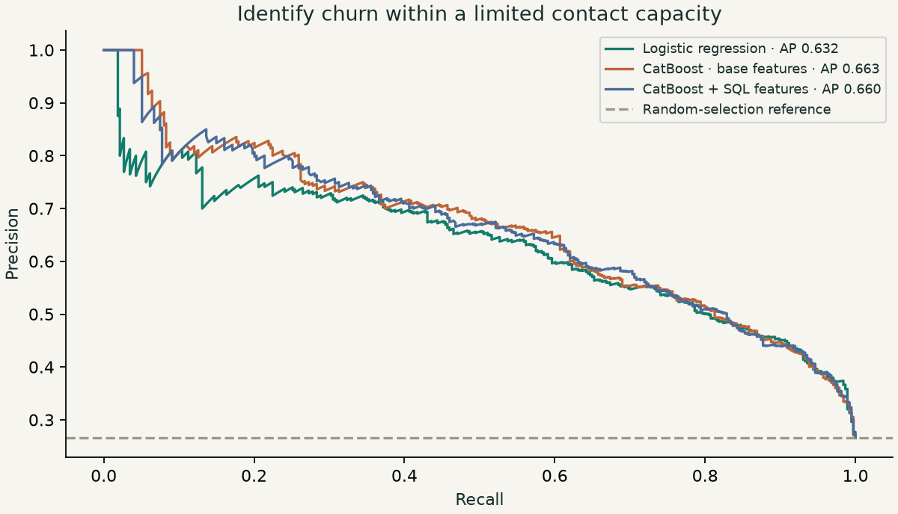
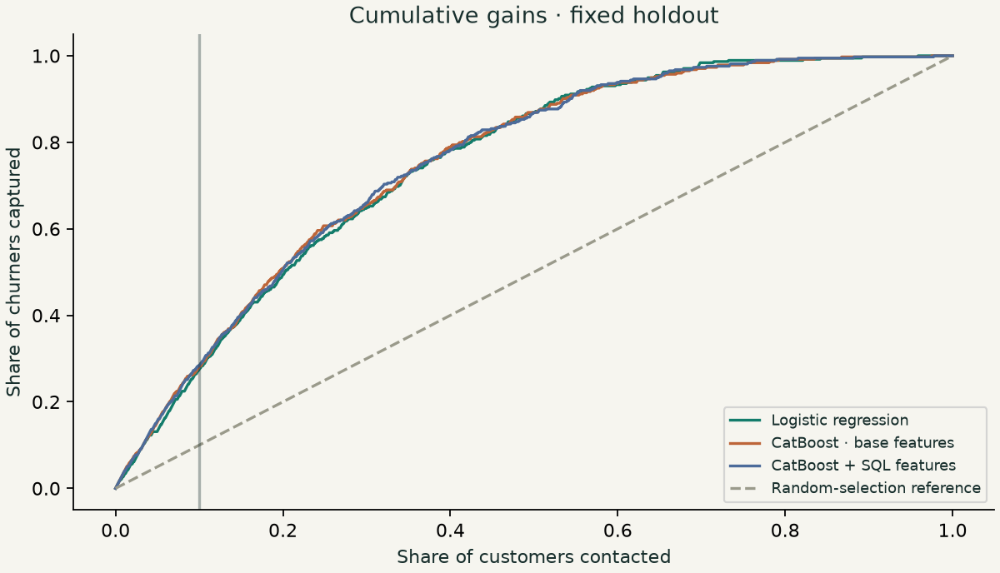
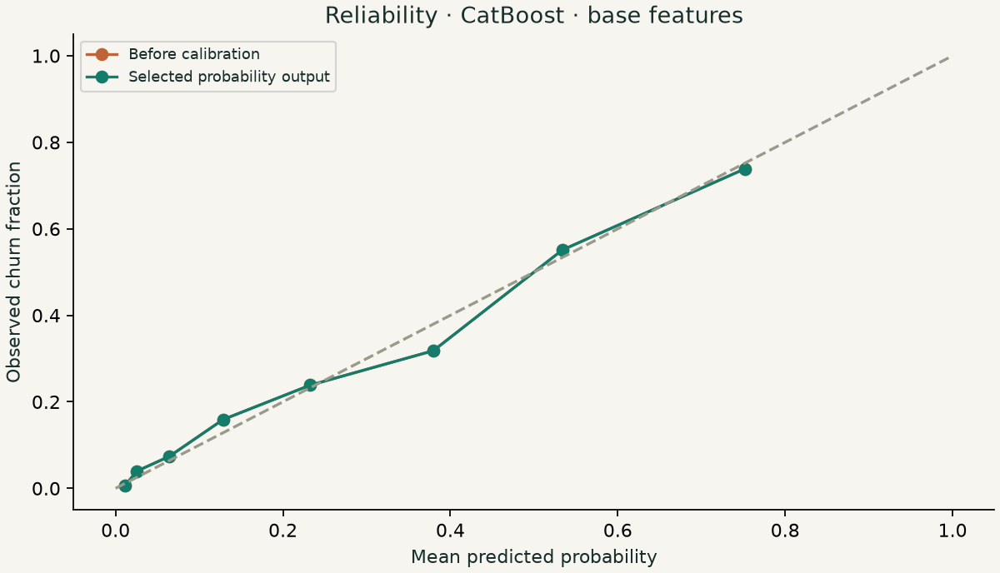
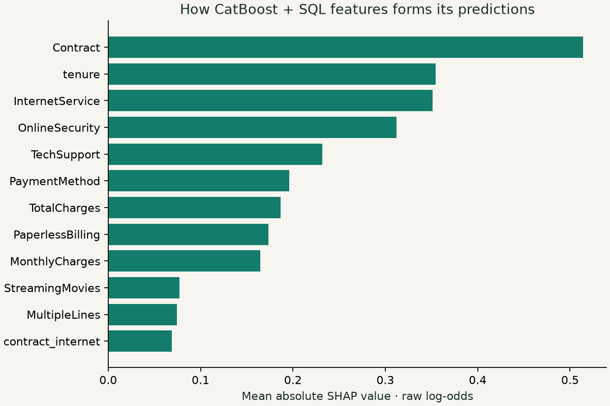

# Experiment results

Author: Ainur Ali

## Frozen evaluation protocol

- Source: IBM Telco sample, 7,043 customers; verified SHA-256.
- Split: 60% training / 10% calibration / 10% policy / 20% test, stratified by label.
- Three-fold CV and Optuna search run inside training only (16 trials).
- Calibration is fitted on its own split. The policy split selects calibration, an F1 threshold and the model with the highest average precision.
- The champion was frozen before reading test labels: **catboost_base**.
- Demographics are retained for descriptive auditing and excluded from model features. This does not establish fairness or remove correlated proxies.

## Holdout results

| Model | ROC-AUC | Average precision | Brier score (lower is better) |
| --- | ---: | ---: | ---: |
| logistic_regression | 0.8400 | 0.6317 | 0.1388 |
| catboost_base | 0.8447 | 0.6630 | 0.1357 |
| catboost_sql | 0.8450 | 0.6603 | 0.1357 |
| constant_baseline | 0.5000 | 0.2654 | 0.1950 |

For the selected model, contacting the top 10% means selecting **141 of 1,409 held-out customers**. This captures **105 of 374 churners**: precision **74.5%**, recall **28.1%**, lift **2.81×** over the holdout prevalence.

The 95% fixed-model bootstrap interval is 0.823–0.865 for ROC-AUC and 0.621–0.708 for average precision (400 stratified resamples).

CatBoost + SQL minus Logistic Regression: AP difference **+0.0286**, paired 95% interval **[+0.0139, +0.0420]**. An interval crossing zero does not support a clear improvement on this holdout.

## What the result supports

The experiment measures ranking, classification and probability reliability on an illustrative customer snapshot. It does not measure customers saved, causal offer effects, future-month performance or performance on Beeline data. Missing observation timestamps prevent a realistic out-of-time validation.

The base-feature CatBoost comparison uses the same hyperparameters selected for the SQL-feature model: it is a fixed-configuration ablation, not a separately optimized benchmark. SHAP explains the CatBoost + SQL model in raw log-odds; it does not identify causes of churn or effects of changing a contract.

The campaign planner uses user-specified assumptions for rescue probability, contribution margin, horizon and costs. The rescue probability is conditional on a customer otherwise churning; no such treatment outcome is observed here. The incentive cost is assumed paid for every contacted customer. Predicted customer value is an illustrative planning quantity, not measured ROI or customer lifetime value.

Bootstrap intervals condition on the fixed fitted models and observed class balance. They exclude retraining uncertainty and future distribution shift. Segment results are descriptive, with small groups suppressed; they are not evidence of causal effects.

## Figures

